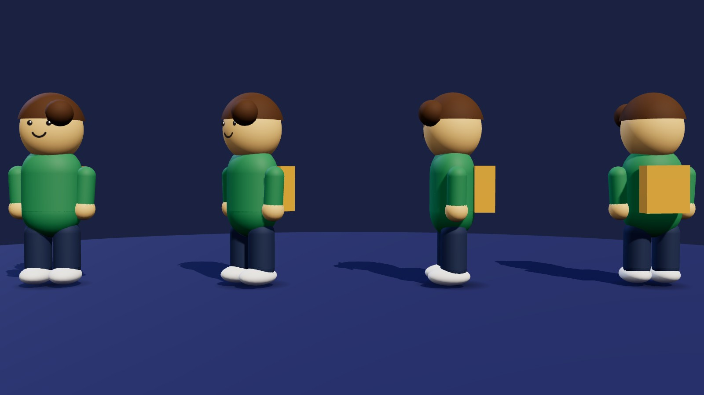
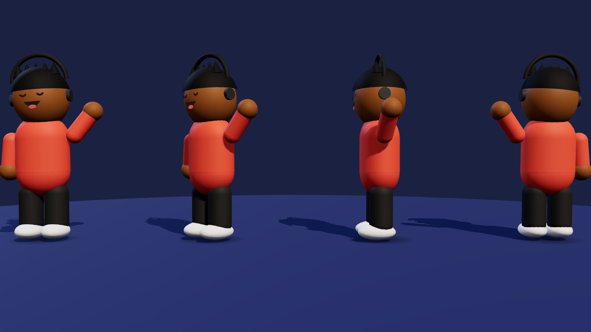
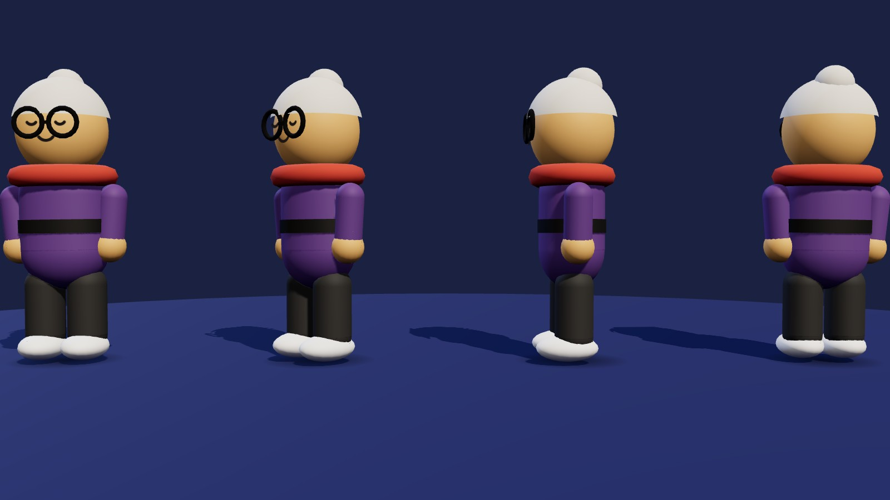
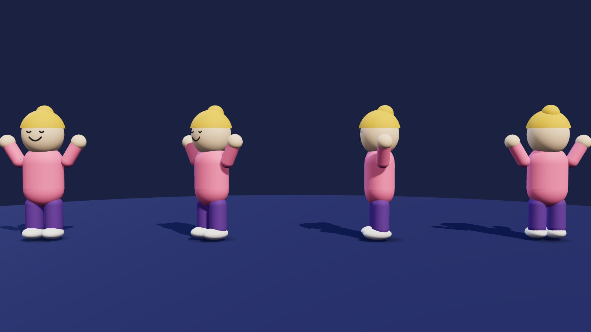
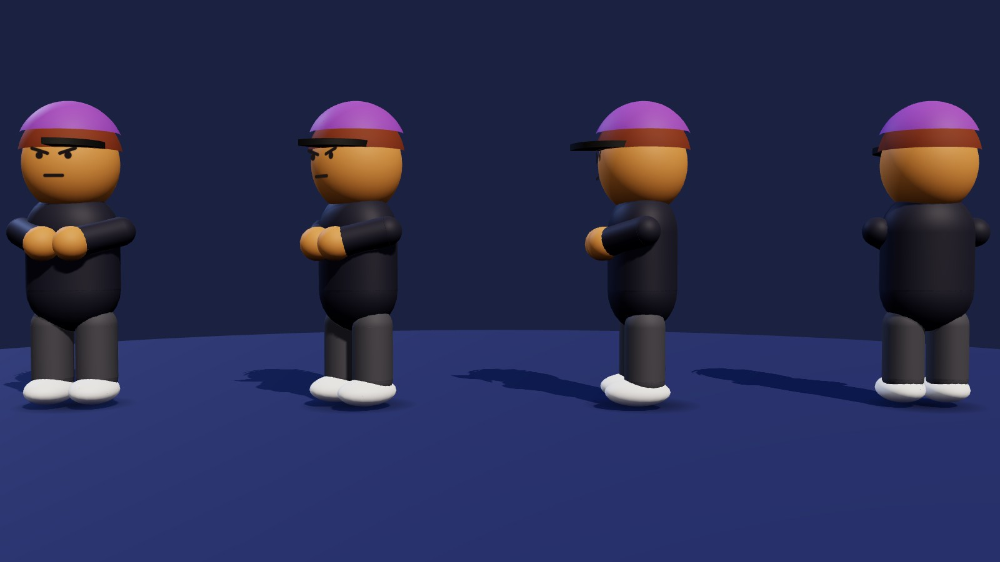
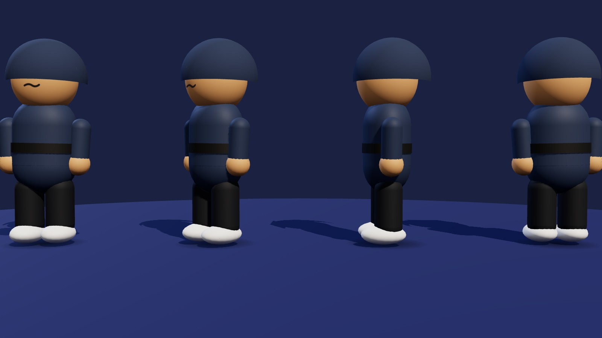

# Character Reference Pack — 6 original characters

Rounded avatars from `shared/avatars_round.js`. Each sheet shows front, three-quarter, side and back. Use them as starting templates and **re-dress them for every new story** (new name, new colours) so no two videos share a cast.

| # | Archetype | Sheet | Colours (hex) | Personality & role | Voice (Kokoro) | Build it (`makeAvatar`) |
|---|---|---|---|---|---|---|
| 1 | **The Quiet Hero** |  | top #3A8A5A · legs #2A3A5A · hair #5A3A1E · backpack #E0A030 | kind, overlooked, secretly does the right thing; the viewer's heart | `am_echo` pitch 1.12 | `{skin:0xf1c27d, hair:0x5a3a1e, hairStyle:'swoop', top:0x3a8a5a, legs:0x2a3a5a, scale:0.85}` + backpack |
| 2 | **The Popular Kid** |  | top #E0503C · legs #2A2A2A · headphones | loud and liked; often the one who changes most | `am_puck` pitch 1.12 | `{skin:0x8d5524, hair:0x111111, hairStyle:'spiky', top:0xe0503c, acc:'headphones', scale:0.9}` |
| 3 | **The Wise Elder** |  | top #6A4A8A · scarf #C04A3A · grey bun, glasses | grandma/teacher/shop owner who knows the secret | `bf_isabella` speed 0.94 pitch 0.93 | `{skin:0xe0ac69, hair:0xdcd8d0, hairStyle:'bun', top:0x6a4a8a, acc:'glasses', scale:0.98}` + scarf |
| 4 | **The Little Sibling** |  | top #FF8AB0 · legs #6A4AA0 · blonde bun, bow | pure joy; the reason the hero is brave | `af_sky` pitch 1.18 | `{skin:0xffe0bd, hair:0xf0c040, hairStyle:'bun', top:0xff8ab0, acc:'bow', scale:0.68}` |
| 5 | **The Rival** |  | top #2A2A3A · cap · arms crossed | mocks the hero, later reveals a soft side | `am_michael` pitch 1.1 | `{skin:0xc68642, hair:0x7a3a1e, hairStyle:'short', top:0x2a2a3a, acc:'cap', scale:0.92}` |
| 6 | **The Mysterious Stranger** |  | hood #34405A · dark clothes | arrives with the twist; good or bad is the question | `bm_george` / `am_fenrir` pitched down | `{skin:0xd9a06a, top:0x34405a, legs:0x22242a, scale:1.05}` + hood |

## Design rules
- Kids scale 0.85, small kids 0.68, adults 1.05. Never two characters with the same top colour in one scene.
- One signature item per hero (beanie, backpack, scarf, bow) so viewers recognise them in wide shots.
- Expressions to use a lot: `smile, happy, laugh, sad, cry (+tears), worried, surprise, angry, warm`; talking mouths come automatically from the voice timing.
- Faces are a flat decal: turn characters 30–45° toward the camera in dialogue and hugs.
