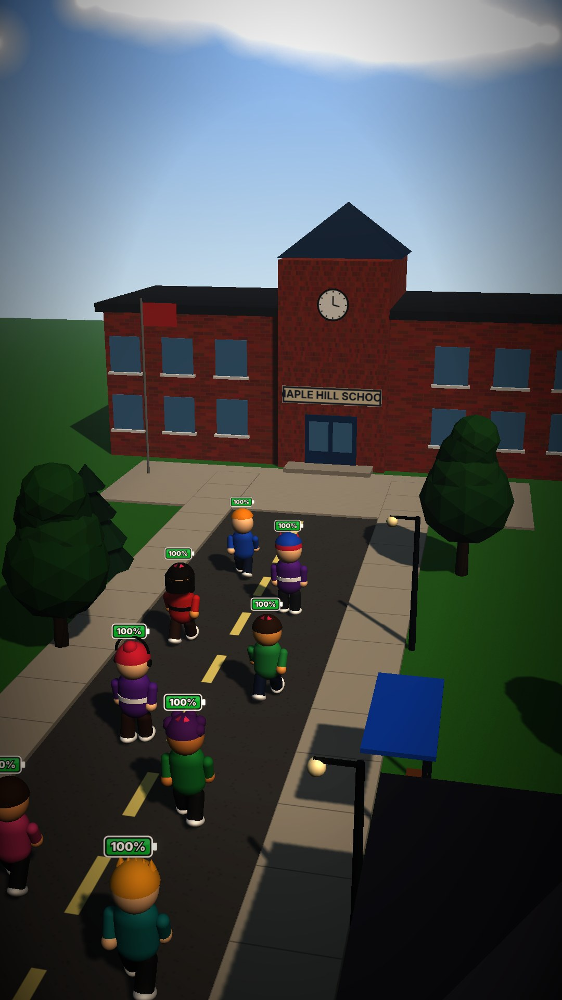
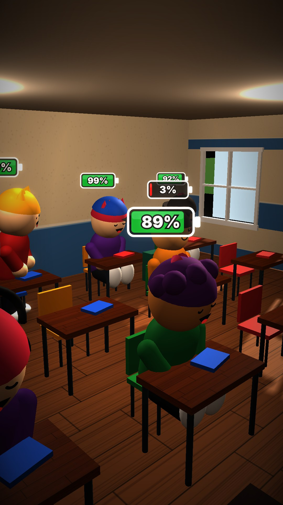
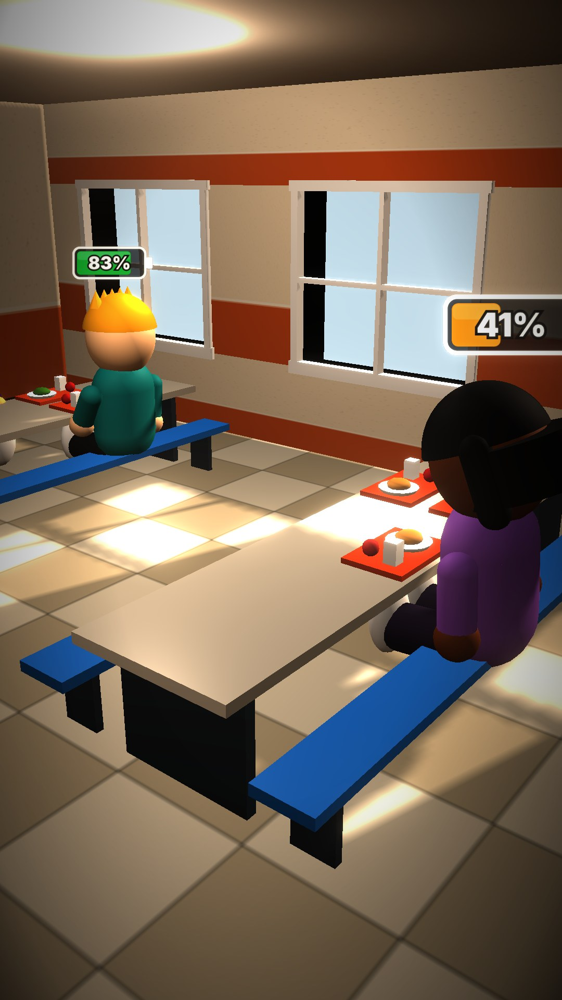
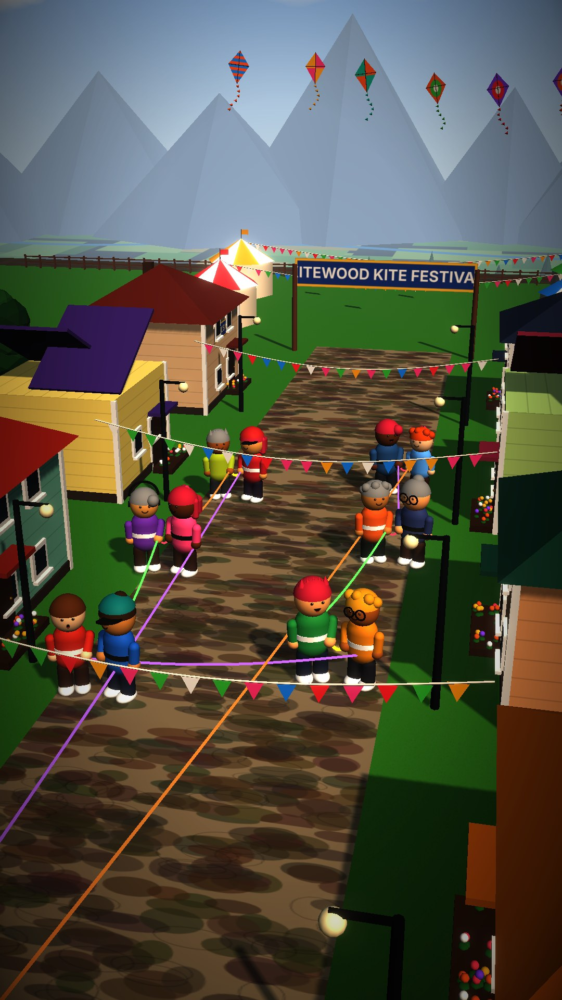
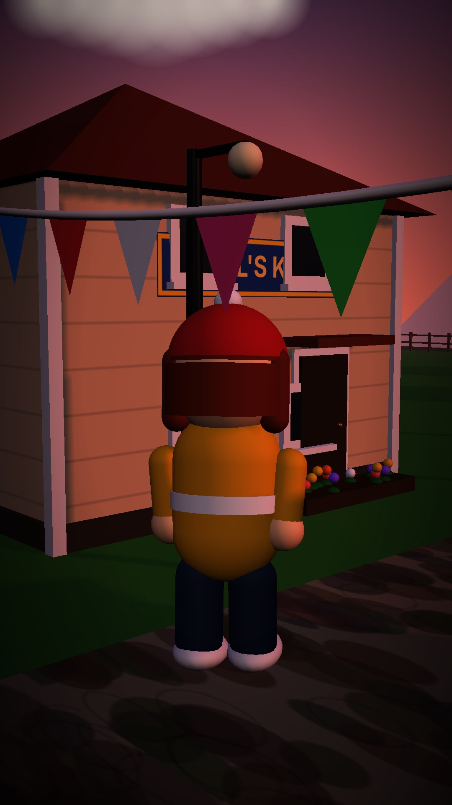
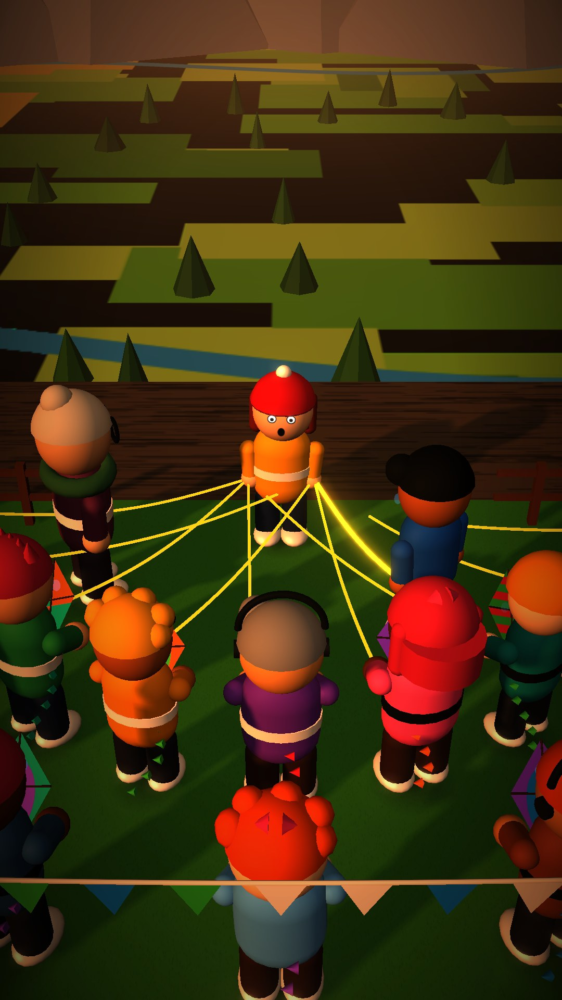

# Environment Reference Pack — 6 original environments

All built in code with `shared/world_kit.js`, `shared/interior_kit.js` and `shared/kite_kit.js`. Each comes with a palette, a lighting mood and story hooks. **Re-use the building blocks, never the same town**: change the name, colours, layout and landmark for every new story.

| # | Environment | Vertical shot | Palette (hex) | Mood & light | Story hooks |
|---|---|---|---|---|---|
| 1 | **Maple Hill — Main Street** (brick school, colourful houses, bus stop) |  | sky #6AB8FF · brick #B4583E · road #6E6A66 · grass #5A9A44 | bright warm day (`setMood('day')`) | a strange rule everyone lives with; the walk to school; the bus stop |
| 2 | **Maple Hill — Classroom** (desks, chalkboard, sunlit windows) |  | wall #F4E8D0 · stripe #6F9FC8 · wood #B8875A | interior day, sun through windows (`'int'`) | the mocking moment; the collapse; the speech that changes everyone |
| 3 | **Maple Hill — Cafeteria** (long tables, trays, menu board) |  | tiles #E8E2D4 · orange stripe #E08A4A · benches #3A8AC8 | busy, bright | the new kid sits alone; a small gift changes everything |
| 4 | **Kitewood — Hill Street** (bunting, flower beds, windmill) |  | pastel walls #FFB0B8 #A8E0D0 #FFF0A0 · bunting mix | sunny festival week | the visible-friendship web; the outsider walking alone |
| 5 | **Kitewood — Dawn at the Kite Shop** |  | dawn sky #4A5A9A → #FFB0A0 · shop #F0D8B8 | pink dawn (`'dawn'`), long shadows | the secret morning routine; foreshadowing the twist |
| 6 | **Kitewood — Cliff at Sunset** (valley, mountains, kites) |  | sunset #FF9A5E → #FFE2B0 · valley greens | golden hour (`'golden'`), bloom up | the finale: everyone gathers, the twist lands, the sky fills |

## Lighting cheat sheet
| Mood | Use for | Key settings |
|---|---|---|
| day | normal life, setup | hemi 1.15, sun 2.8 warm-white |
| int | rooms | white hemi 1.3–1.35, sun through windows 3.4–3.6, room lights ~10 |
| dawn | secrets, quiet beginnings | pink/blue sky, sun low 1.4 |
| storm | crisis | grey sky, hemi ~2.2, rain field, front fill 0.9 |
| golden | payoff, ending | orange sky, sun 3.0 from the side, bloom 0.45–0.55 |
| intNight | sadness, alone | blue hemi ~1.45, warm lamp 5 |
Always add the camera-side front fill (~0.85) so faces stay readable.
