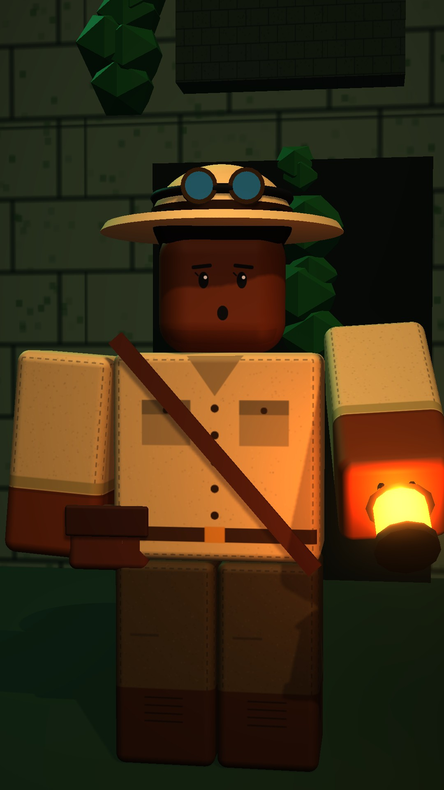
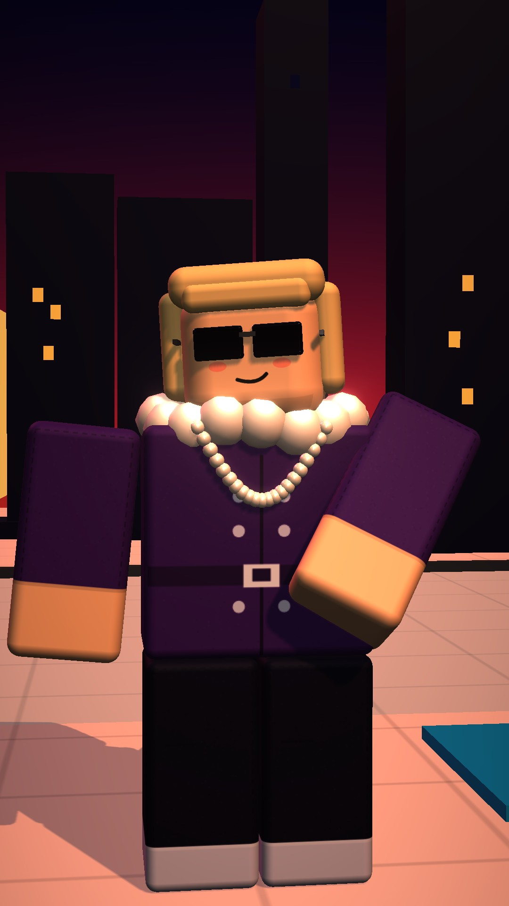
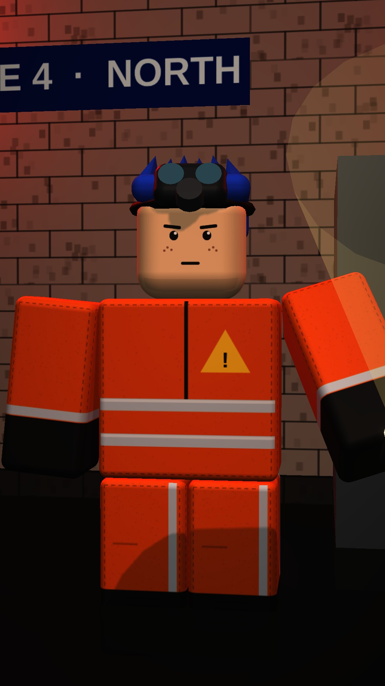
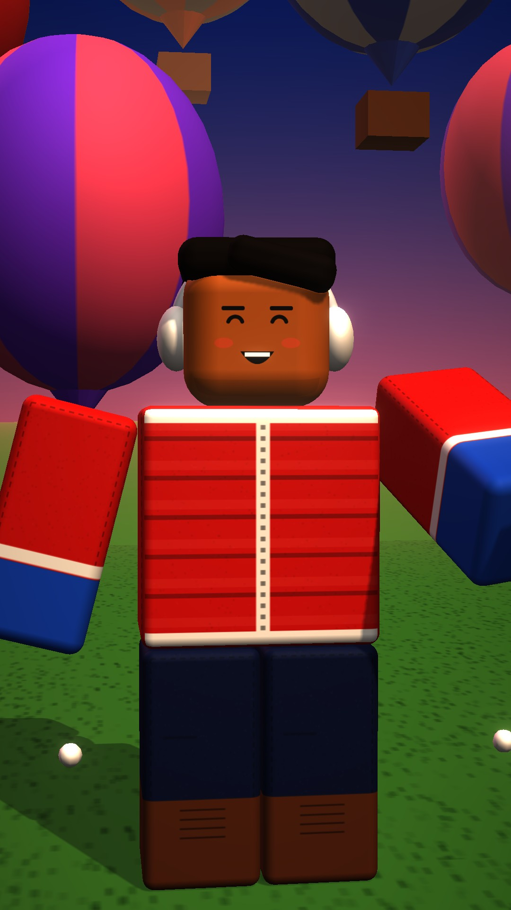

# Block-Style Character Pack — 4 original detailed characters

A second, more detailed look: rounded-edge **block avatars** from `shared/avatars_block.js` (Roblox-like proportions, painted clothing on every side, many 3D accessories). All designs are original. Re-dress and re-name them for every new story.

| # | Character | Picture | Signature details | Mood & world | Build it (`makeBlockAvatar`) |
|---|---|---|---|---|---|
| 1 | **The Explorer** (Mystery) |  | pith hat with brass goggles, ponytail, safari shirt with flap pockets, crossbody satchel, belt, boots, glowing lantern | curious, brave; overgrown jungle temple, teal haze | `{shirt:'safari', color:0xc8b48a, hat:'explorer', hair:{style:'ponytail'}, satchel:0x7a4a2a, prop:'lantern', boots:true}` |
| 2 | **The Heiress** (Drama) |  | blonde bob, sunglasses, fur collar, pearl necklace, belted purple coat with silver buttons | proud, hides a soft heart; penthouse rooftop at sunset | `{shirt:'coat', color:0x6a3a8a, hair:{style:'bob'}, glasses:'sunglasses', pearls:true, fur:0xf4eee8}` |
| 3 | **The Rescuer** (Thriller) |  | blue pixie hair, gas mask on the forehead, orange hazmat suit with reflective stripes and "RESCUE" on the back, gloves, flashlight with a beam | calm under pressure; flooded subway, red alarms | `{shirt:'hazmat', color:0xf07a1a, hair:{style:'pixie'}, hat:'gasmask', prop:'flashlight', gloves:0x2a2a2a, boots:true}` |
| 4 | **The Balloon Kid** (Adventure) |  | quilted red puffer jacket with white trim, earmuffs, blue mittens, boots, golden ticket | excited, dreams big; hot-air balloon festival at dawn | `{shirt:'puffer', color:0xd8322a, hat:'earmuffs', gloves:0x3a7ad8, prop:'ticket', boots:true}` |

## Building blocks you can mix
- **Clothing:** `tee`, `suit`, `jacket`, `uniform`, `tunic`, `safari`, `coat`, `hazmat`, `puffer` — each painted front and back, with sleeves, cuffs, pants stripes, shoes or boots, gloves.
- **Hair:** `curly`, `slick`, `swoop`, `bun`, `long`, `bob`, `ponytail`, `pixie` (any colour).
- **Hats:** `explorer`, `earmuffs`, `gasmask`, `cap`, `beanie`, `bandana`, `conductor`, `tophat`, `nemes`.
- **Extras:** glasses (`round`, `square`, `gold`, `sunglasses`), chain, pearls, fur collar, scarf, belt, backpack, satchel; props in hand: `lantern`, `flashlight`, `ticket`.
- **Faces:** `smile, grin, smug, stern, angry, sad, surprise` + options mustache, beard, freckles, blush, lashes.
- Metals only shine with an environment map: add `scene.environment` (RoomEnvironment through PMREM, intensity ~0.22).

## Rules that keep it original
- Never rebuild another creator's character 1:1. Change at least the genre, the outfit, the signature item and the world.
- One signature item per hero, visible in wide shots (lantern, fur collar, gas mask, earmuffs).
